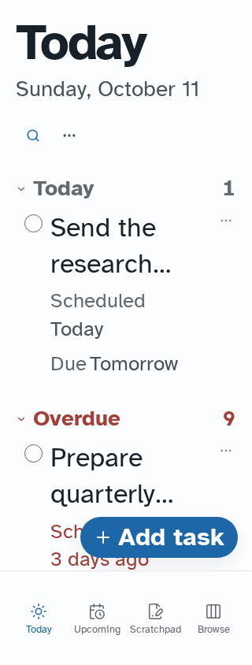
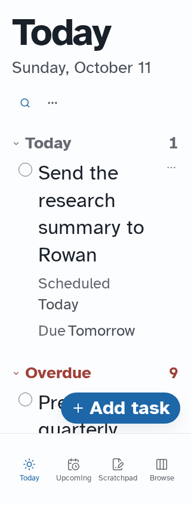

# Task title wrapping

Local e2e demo, 320 × 844, 200% root text. No accounts or live collection data.

Task titles now wrap fully instead of stopping after two lines. Unbroken text
wraps within the title column. Compact row spacing and separate title, property,
completion, and overflow targets remain unchanged.

| Before                                              | After                                                        |
| --------------------------------------------------- | ------------------------------------------------------------ |
|  |  |

Regression coverage: `e2e/task-density.spec.ts`, light/dark and desktop/touch.
